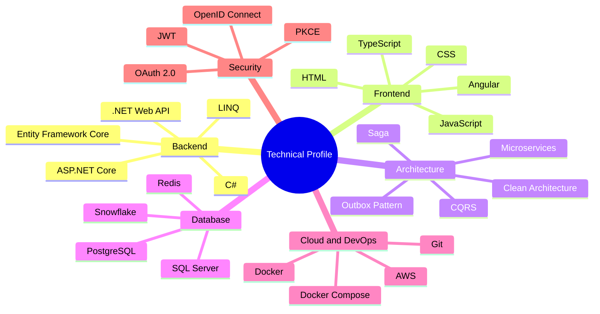
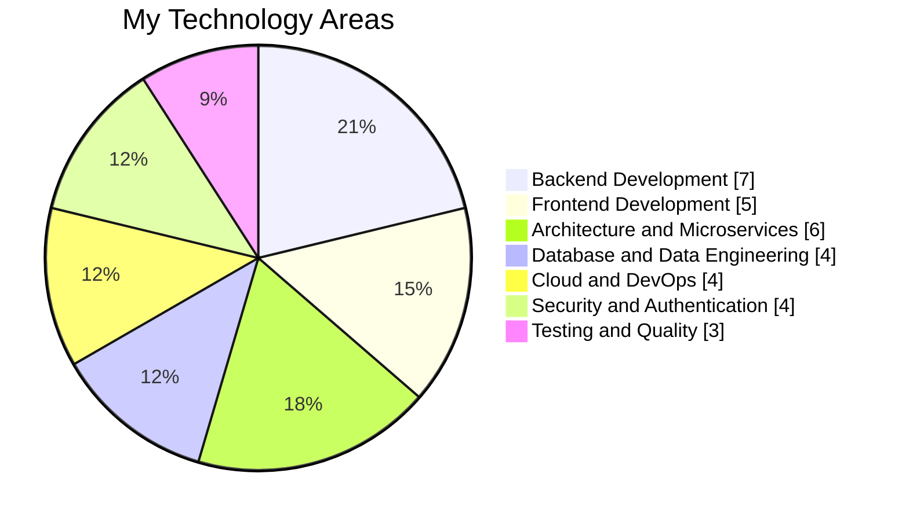
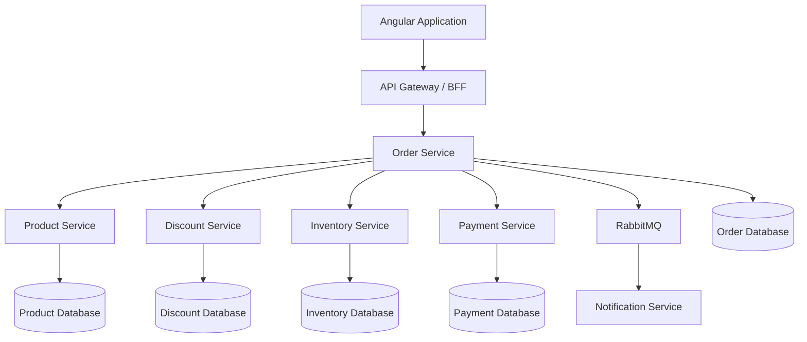
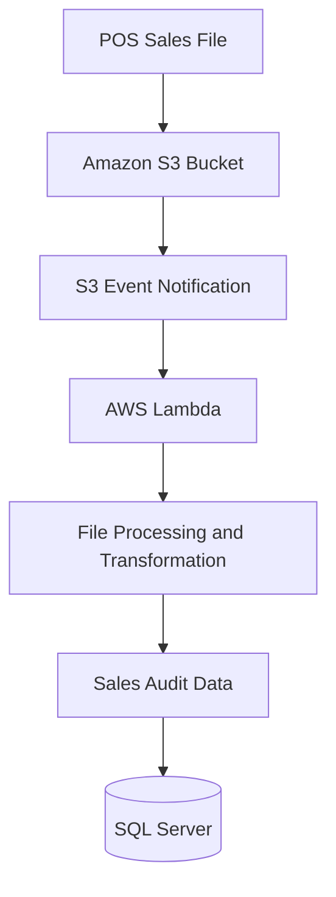

# Naresh Devabathini | .NET Full Stack Developer

**Software Engineer | .NET | Angular | Microservices | Cloud | Database Engineering**

Welcome to my GitHub profile!

I am a software developer with experience in designing, developing, maintaining and enhancing enterprise applications using Microsoft technologies and modern full-stack development practices.

My primary technical stack includes **C#, ASP.NET Core, .NET Web API, Angular, SQL Server, Entity Framework Core and Microservices Architecture**.

I use GitHub to document my technical knowledge, build practical implementations, explore modern technologies, solve real-world development problems and continuously improve my software engineering skills.

---

# 1. My Technical Profile

## Technology areas

The following chart groups the technologies I work with and explore.

*Illustrative category grouping, not a measurement of skill level or years of experience.*

---

# 2. Backend Development – .NET

My primary development area is Microsoft .NET technologies.

### Technologies

- C#
- .NET Core
- .NET 8
- .NET 10
- ASP.NET Core Web API
- Minimal APIs
- MVC
- Entity Framework Core
- EF Core Code First
- LINQ
- ADO.NET
- Dapper
- Dependency Injection
- Middleware
- Background Services
- RESTful API Development
- Asynchronous Programming
- Task-based Programming
- Exception Handling
- Logging
- Configuration Management

### Concepts I explore and implement

- SOLID Principles
- Design Patterns
- Repository Pattern
- Unit of Work
- Generic Repository
- Clean Architecture
- Vertical Slice Architecture
- CQRS
- Domain-Driven Design fundamentals
- Dependency Injection
- Async/Await
- Thread Pool
- Multithreading and Concurrency

---

# 3. Frontend Development – Angular

I work with Angular to build modern, component-based frontend applications.

### Technologies

- Angular
- Angular 14
- Angular 20/21 learning and exploration
- TypeScript
- JavaScript
- HTML5
- CSS3
- Angular Material
- RxJS
- Reactive Forms
- Template-driven Forms
- Angular Router
- HTTP Client
- Route Guards
- HTTP Interceptors

### Modern Angular concepts

- Signals
- Computed Signals
- Effects
- Input and Output
- Linked Signals
- Resources
- toSignal()
- toObservable()
- ViewChild and ContentChild
- DestroyRef
- takeUntilDestroyed()
- Component Lifecycle Hooks
- Change Detection
- OnPush Change Detection
- Lazy Loading
- Route Guards
- Custom Directives
- Custom Pipes
- Content Projection
- ng-template
- ng-container

### RxJS concepts

- Observable
- Subject
- BehaviorSubject
- ReplaySubject
- switchMap
- mergeMap
- concatMap
- exhaustMap
- forkJoin
- combineLatest
- debounceTime
- catchError
- takeUntil

---

# 4. Microservices Architecture

I explore and implement microservices using ASP.NET Core.

### Architecture and communication

- Microservices Architecture
- REST API Communication
- gRPC
- RabbitMQ
- Event-Driven Architecture
- Asynchronous Messaging
- API Gateway
- Service-to-Service Communication
- Distributed Systems

### Distributed application patterns

- Saga Pattern
- Transactional Outbox Pattern
- Database-per-Service
- Eventual Consistency
- Idempotency
- Retry Mechanism
- Circuit Breaker
- Correlation ID
- Distributed Logging
- Health Checks

### Example: E-Commerce Microservices

### Example business workflow

1. Customer places an order.
2. Order Service receives the request.
3. Product Service validates product details.
4. Discount Service calculates the discount.
5. Inventory Service checks stock availability.
6. Payment Service processes payment.
7. RabbitMQ publishes relevant business events.
8. Notification Service sends order confirmation.

The example demonstrates how independent services communicate and coordinate business workflows.

---

# 5. Database and Data Engineering

### SQL and relational databases

- Microsoft SQL Server
- PostgreSQL
- SQL Queries
- Stored Procedures
- Views
- Common Table Expressions
- Window Functions
- Indexing
- Query Optimization
- Transactions
- Database Design
- Entity Framework Core
- Code First Migrations

### Snowflake

- Snowflake Data Warehouse
- SQL Development
- Change Data Capture (CDC)
- SQL Server to Snowflake Synchronization
- Data Integration
- Data Transformation

### Redis

- Distributed Caching
- Cache Management
- Cache Expiration
- Redis with Docker
- Cache-aside Pattern

### MicroStrategy

- MicroStrategy Desktop
- Report Development
- Attributes
- Metrics
- Reporting
- Analytical Reports

---

# 6. AWS and Cloud Development

I have worked with and explored AWS services for cloud-based application development and event-driven processing.

### AWS technologies

- AWS Lambda
- Amazon S3
- S3 Event Notifications
- Amazon EC2
- IAM fundamentals
- Cloud-based application integration

### Example: POS Sales File Processing

### Example workflow

1. POS systems generate sales transaction files.
2. Files are uploaded to an S3 bucket.
3. S3 event notification triggers an AWS Lambda function.
4. Lambda processes and transforms the incoming files.
5. Validated transaction data is loaded into the Sales Audit system.

---

# 7. Security and Authentication

I explore authentication and authorization mechanisms for securing Angular and .NET applications.

### Technologies and protocols

- JWT
- OAuth 2.0
- OpenID Connect (OIDC)
- Authorization Code Flow
- PKCE
- Refresh Tokens
- IdentityServer
- OpenIddict
- ASP.NET Core Authentication
- ASP.NET Core Authorization
- Role-based Authorization
- Policy-based Authorization
- Claims-based Authorization

### Application security concepts

- Authentication vs Authorization
- Access Token Validation
- Refresh Token Management
- Issuer Validation
- Audience Validation
- CORS
- HTTP Interceptors
- Route Guards
- Backend for Frontend (BFF)
- Secure Cookie-based Sessions
- CSRF Protection

---

# 8. Docker and DevOps

### Technologies

- Docker
- Docker Compose
- Git
- GitHub
- GitHub Repositories
- Containerization
- Multi-stage Docker Builds
- Environment Configuration
- Container Networking
- PostgreSQL Containers
- Redis Containers
- RabbitMQ Containers

### Concepts

- Dockerfile
- Docker Images
- Docker Containers
- Docker Volumes
- Docker Networks
- Environment Variables
- Container Logs
- Multi-container Applications

---

# 9. Testing and Code Quality

### Testing technologies

- NUnit
- Moq
- Unit Testing
- Integration Testing
- Test-driven Development fundamentals
- Dependency Mocking
- Test Assertions
- Test Cases
- Code Coverage fundamentals

### Concepts

- Arrange, Act, Assert (AAA)
- Mock Dependencies
- Verify Method Calls
- Exception Testing
- Isolating Business Logic

---

# 10. Enterprise Project Experience

## Aptos Retail – Sales Audit

Worked on an enterprise retail transaction-processing and Sales Audit application.

### Project overview

Aptos Sales Audit processes sales transactions generated by Aptos ONE POS systems.

The system receives POS sales files, transforms raw transaction data into structured files, validates transaction details and loads valid data into SQL Server staging and Sales Audit tables.

### Business functionality

- POS transaction processing
- Sales file transformation
- Merchandise and discount processing
- Returns and tax processing
- Tender and customer information processing
- Transaction validation
- Exception management
- Sales reconciliation
- Reporting
- Day-end audit activities

### Technologies and tools

- C#
- .NET
- SQL Server
- AWS S3
- AWS Lambda
- MicroStrategy
- SQL
- Event-driven processing

---

# 11. What I Am Currently Learning and Exploring

I believe software development requires continuous learning.

My current learning areas include:

| Area | Technologies / Concepts |
|---|---|
| Modern .NET | .NET 10, advanced C# |
| Angular | Angular 21, Signals, modern APIs |
| Cloud | AWS development and cloud integration |
| AI Development | Generative AI, AI agents, MCP, Microsoft Agent Framework |
| Microservices | RabbitMQ, Saga, Outbox, distributed systems |
| Security | OIDC, PKCE, BFF, OpenIddict |
| Data Engineering | Snowflake, CDC |
| Architecture | Clean Architecture, Vertical Slice, CQRS |
| Testing | NUnit, Moq, automated testing |

*Learning and exploration topics are not necessarily production project experience.*

---

# 12. Why I Use GitHub

GitHub is more than a place to store source code.

I use GitHub as my technical knowledge repository and practical engineering portfolio.

### My reasons for using GitHub

**1. Document Technical Knowledge**

I maintain Markdown documentation explaining concepts, architecture, implementation approaches and technical decisions.

**2. Practical Implementation**

I create sample applications to understand how technologies work in real-world scenarios.

**3. Continuous Learning**

I explore new .NET, Angular, AWS, database and architecture features and document my findings.

**4. Reusable Code Examples**

I maintain reusable code snippets, utilities, configurations and implementation examples.

**5. Track Development Progress**

Git commits help me track changes, improvements and the evolution of my projects.

**6. Demonstrate Technical Skills**

My repositories provide recruiters and developers with examples of my practical knowledge beyond my resume.

**7. Prepare for Technical Interviews**

I document important concepts, interview questions, design patterns and problem-solving approaches.

---

# 13. My GitHub Learning and Implementation Projects

Some of the areas I maintain or explore through practical repositories:

| Project | Technologies |
|---|---|
| Angular Learning Application | Angular 21, Signals, RxJS, Routing |
| .NET Microservices | ASP.NET Core, Docker, PostgreSQL |
| E-Commerce Microservices | Order, Product, Basket, Discount |
| Event-Driven Architecture | RabbitMQ, .NET, Clean Architecture |
| Authentication Application | Angular, OIDC, PKCE, .NET |
| Redis Distributed Cache | Redis, Docker, .NET |
| Sales Audit Processing | .NET, AWS S3, Lambda, SQL Server |
| Snowflake Integration | SQL Server, CDC, Snowflake |
| Unit Testing Examples | NUnit, Moq |

These repositories serve as learning and implementation references. Production experience and personal practice projects are distinguished in their individual documentation.

---

# 14. My Development Philosophy

- Write clean, maintainable and reusable code.
- Follow SOLID principles and appropriate design patterns.
- Build applications with scalability and maintainability in mind.
- Understand the business problem before implementing a solution.
- Prefer asynchronous programming for I/O-bound operations.
- Design reliable communication between distributed services.
- Write unit tests for important business logic.
- Document technical decisions and implementation details.
- Keep learning modern technologies and development practices.

---

# 15. Connect With My Technical Work

I use this GitHub profile to share my learning journey, technical implementations, architecture examples and practical development experiments.

**My objective is simple:**

Learn the technology, understand the concepts, implement them through real-world examples and document the knowledge so that other developers can learn from it too.

Thanks for visiting my GitHub profile!
